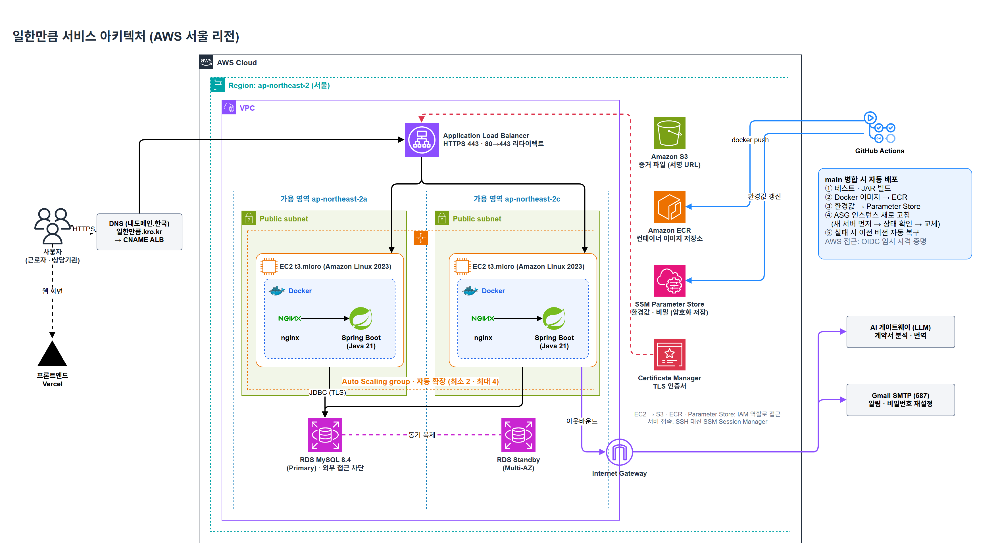
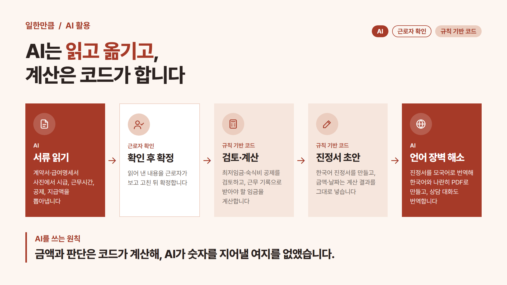

<h1 align="center">일한만큼 — Backend</h1>

<p align="center">이주노동자가 근무를 기록하고, 받아야 할 임금과 실제 받은 임금을 비교해<br>모국어로 진정서를 준비하고 상담기관에 도움을 요청할 수 있게 돕는 서비스의 백엔드</p>

<p align="center">Spring Boot 4 · Java 21 · MySQL(RDS) · AWS(ALB · Auto Scaling · Docker · S3) · GitHub Actions(OIDC) · 2026 해커톤</p>

> **운영 상태**: 해커톤 기간에 `https://일한만큼.kro.kr`에서 운영했고 현재는 서버를 내렸습니다. 운영 당시 실제 응답은 [`docs/api-examples/`](docs/api-examples/README.md), 화면은 [front 저장소의 `docs/screenshots/`](https://github.com/easython-2026/front/tree/main/docs/screenshots)에 남겨 두었습니다.

## 무엇을 하나

| 기능 | 백엔드가 하는 일 |
| --- | --- |
| **GPS·사진 출퇴근** | 근무지 반경 100m 인증 → 1회용 인증 토큰 → 사진 + 서버 시각으로 기록. 사후 입력·수정은 사유와 변경 이력을 남김 |
| **근로계약서·급여명세서 분석** | 이미지/PDF를 AI로 읽어 시급·근무시간·공제·지급액 추출, 조항 원문·번역·위치, 모국어 요약 |
| **급여 비교** | 확정 계약 + 근무기록으로 받아야 할 임금을 계산(기본급·연장 1.5배 등)해 실제 수령액과 비교, 최저임금·숙식비 공제·휴게시간 검토 |
| **이상 근무 탐지** | 무휴게 장시간, 2시간 이상 사후 시간 변경, 반복 퇴근 누락 |
| **진정서** | 한국어 초안은 템플릿으로 생성(금액·날짜는 계산값 그대로), AI는 모국어 번역만 → 한국어·모국어 대조 PDF |
| **상담 연결** | 근로자가 고른 범위만 상담기관에 공유(철회 가능), 메시지 양방향 자동 번역, 기관 측 접수·분류·배정·자료 요청·연계·종결 |
| **다국어** | 한국어·영어·베트남어. 오류 메시지·검토 문구까지 사용자 언어로 |

## 아키텍처

<p align="center"></p>

- **ALB(HTTPS) → Auto Scaling 그룹(EC2 2대, 서울 2a·2c) → Docker(nginx + 앱)**. 앱이 무상태(JWT·S3·RDS)라 수평 확장에 코드 수정이 없음
- **RDS MySQL Multi-AZ**(외부 접근 차단, TLS 검증), **S3** 증거 파일은 비공개 + 만료 시간이 있는 서명 URL(사진 30분)
- 비밀값은 GitHub Secrets → **SSM Parameter Store(SecureString)** → 인스턴스가 기동 시 읽음. **SSH 키·22번 포트 없음**(SSM Session Manager)
- 같은 도메인에서 nginx가 `/api/v1` → 백엔드, `/` → 사용자 앱, `/admin/` → 관리자 웹(Vercel)으로 나눠 CORS 불필요
- 구성도 원본: [`docs/architecture.drawio`](docs/architecture.drawio) · 배포 스크립트·설정: [`deploy/`](deploy/README.md)

## AI를 쓰는 방식

<p align="center"></p>

- AI는 **서류 읽기(추출)와 번역**만 맡고, **금액·법적 판단은 코드**가 계산 → AI가 숫자를 지어낼 여지를 없앰
- 추출 결과는 근로자가 확인·수정 후 **확정**해야 계산에 쓰임(Human-in-the-loop)
- `AiClient` 인터페이스 뒤에 실제 게이트웨이(`GatewayAiClient`, OpenAI 호환 · Claude Haiku)와 모의 구현(`MockAiClient`) → 키 없이도 로컬·테스트가 동작
- 분석·번역은 비동기(`202 Accepted` → 상태 조회)로 처리해 요청 스레드를 붙잡지 않음
- 응답은 JSON 스키마로 강제하고 파싱 실패·타임아웃은 상태(`FAILED` + 사유)로 남겨 재시도 가능

## 설계 포인트

- **위조하기 어려운 근무 기록**: GPS 인증 토큰은 1회용·5분 만료, 사진 해시·서버 시각 저장, 수동 입력은 `MANUAL`로 구분해 진정서에도 "사후 입력"이라고 사실대로 기재
- **증거 무결성**: 업로드 파일 SHA-256 해시, 다운로드는 서명 URL로만
- **동의 기반 공유**: 상담기관은 근로자가 동의한 범위(요약·계약서·근무기록·명세서·진정서)만 조회, 조회 기록(AccessLog) 남김, 동의 철회 시 즉시 차단
- **개인정보 삭제**: 회원 탈퇴·삭제 요청 시 DB와 S3 원본까지 정리
- **공통 응답·오류 형식**: `{ success, data, message, errorCode }`, 오류 코드는 고정 enum, 메시지는 사용자 언어

## API

Base URL `/api/v1` · 인증 `Authorization: Bearer <JWT>` · 전체 75개 엔드포인트 · [실제 요청·응답 예시 20개](docs/api-examples/README.md)

| 도메인 | 주요 엔드포인트 |
| --- | --- |
| 인증 (7) | `POST /auth/signup` `POST /auth/login` `POST /auth/refresh` `POST /auth/logout` 비밀번호 재설정 |
| 회원·설정 (10) | `GET /users/me` `PUT /users/me/workplace` `PATCH /users/me/consents` `POST /users/me/data-deletion-requests` `GET /languages` |
| 출퇴근 (12) | `POST /attendance/location-check` `POST /attendance/clock-in` `clock-out` `GET /attendance/today·weekly·monthly` `GET /attendance/anomalies` 수동 입력·수정 |
| 근로계약서 (7) | `POST /contracts`(업로드·AI 분석) `GET /contracts/{id}` `PATCH …/terms` `POST …/confirm` `…/reanalyze` |
| 급여 (7) | `POST /payroll/statements`(명세서 분석) `…/manual` `POST /payroll/comparisons` `GET /payroll/comparisons?month=` |
| 진정서·리포트 (8) | `POST /complaints` `GET /complaints/{id}` `PATCH`(수정·확정) `GET …/pdf` `GET /reports/monthly` `GET /evidences` |
| 상담 (7) | `GET /consultation-agencies` `POST /consultations` `GET /consultations/{id}` 메시지 `DELETE …/consent` |
| 관리자 (13) | `POST /admin/auth/login` `GET /admin/dashboard` `GET /admin/consultations` 분류·배정·자료 요청·연계·상태·종결·메시지 |
| 기타 (4) | 알림 목록·읽음, 파일 다운로드(서명 URL), 데모 데이터 |

## 패키지 구조

```
src/main/java/com/easython/
├─ auth          회원가입·로그인·JWT 재발급·비밀번호 재설정
├─ user          내 정보·근무지·동의·탈퇴/삭제(DataPurgeService)
├─ attendance    GPS 인증·출퇴근·수동 기록·변경 이력·이상 패턴
├─ contract      계약서 업로드·AI 분석(ContractAnalyzer)·검토(ReviewService)
├─ payroll       명세서 분석·임금 계산(PayrollCalculator)·비교
├─ complaint     진정서 초안(ComplaintDraftBuilder)·번역·PDF(ComplaintPdf)
├─ consultation  상담 신청·공유 동의·메시지·관리자 업무(AdminService)
├─ report        월간 리포트·증거 목록
├─ notification  알림·월급날 알림
├─ ai            AiClient(게이트웨이/모의)
├─ storage       로컬/S3 저장소, 서명 URL
├─ security      JWT 필터·권한(근로자/상담기관)
└─ common        공통 응답·오류 코드·다국어·시간대
```

## CI/CD

> 운영 당시 구성입니다. 서버 종료 후 배포 단계와 GitHub production 환경(비밀값)은 제거했고, 지금 워크플로는 PR·push 테스트만 돌립니다. 배포 단계 원본은 git 기록에서 볼 수 있습니다.

```
PR/push ─▶ GitHub Actions: ./gradlew test bootJar
main 병합 ─▶ Docker 이미지 빌드 → ECR push → 환경값 SSM 갱신
         ─▶ ASG instance refresh(새 서버 먼저 → ALB 상태 확인 통과 후 교체, 무중단)
         ─▶ 실패 시 이전 이미지·환경값으로 자동 복구 → 공개 헬스체크
```

- AWS 접근은 **GitHub OIDC 임시 자격 증명**(장기 액세스 키 없음), 배포 역할은 ECR·SSM·ASG 최소 권한
- 워크플로: [`.github/workflows/ci-cd.yml`](.github/workflows/ci-cd.yml) · 서버 시작 스크립트: [`deploy/asg-user-data.sh`](deploy/asg-user-data.sh)

## 로컬 실행

```bash
./gradlew bootRun          # 기본: 메모리 H2(MySQL 모드) + AI 모의 응답, 설치 불필요
```

```bash
./gradlew test             # 통합 흐름·단위 테스트 14개 클래스(실제 AI 호출 없음)
```

로컬 MySQL:

```bash
docker compose up -d
DB_URL="jdbc:mysql://localhost:3306/easython?serverTimezone=Asia/Seoul&characterEncoding=UTF-8" DB_USERNAME=easython DB_PASSWORD=easython ./gradlew bootRun
```

실제 AI 호출 확인(유료 크레딧, 평소엔 건너뜀):

```bash
AI_LIVE_TEST=1 AI_API_KEY=... ./gradlew test --tests '*GatewayAiLiveTest'
```

## 환경변수 (`.env.example` 참고, 실제 값은 절대 커밋하지 않기)

| 이름 | 설명 | 기본값 |
|---|---|---|
| `DB_URL` `DB_USERNAME` `DB_PASSWORD` | DB 접속 | H2 메모리 |
| `DDL_AUTO` | Hibernate ddl-auto | `update` |
| `JWT_SECRET` | JWT 서명 키(32바이트 이상). **데모 모드가 아니면 필수**(미지정 시 기동 실패) | 개발용 고정값 |
| `CORS_ORIGINS` | 허용 프론트 주소(쉼표 구분) | `http://localhost:5173,http://localhost:3000` |
| `AI_API_KEY` (또는 `DKU_API_KEY`) | AI 게이트웨이 키. 없으면 데모용 모의 응답 | - |
| `AI_BASE_URL` `AI_MODEL` | OpenAI 호환 게이트웨이 주소·모델 | dku-chat / `anthropic/claude-haiku-4.5` |
| `AI_PROVIDER` | `mock` 강제 모의, `gateway` 실제 키 필수 | 로컬 자동, 운영 `gateway` |
| `STORAGE_BACKEND`, `AWS_REGION`, `S3_BUCKET` | `local` 또는 `s3` 저장소 설정 | 로컬 `local`, 운영 `s3` |
| `STORAGE_DIR` | 증거 파일 저장 폴더 | `~/easython-uploads` |
| `PUBLIC_BASE_URL` | 파일 서명 URL 앞에 붙일 주소 | (상대경로) |
| `PDF_FONT_PATH` | 진정서 PDF 한글 TTF(Noto Sans KR 권장). 없으면 시스템 폰트 탐색 | - |
| `MAIL_USERNAME` `MAIL_PASSWORD` | Gmail SMTP(앱 비밀번호). 비우면 메일 미발송 | - |
| `DEMO_ENABLED` | 데모 시드 API·데모 기관/담당자 계정. **배포 시 `false`** | `true` |
| `DEMO_STAFF_PASSWORD` | 데모 담당자 계정(`staff@agency.org`) 비밀번호 | `Test1234!` |

## 구현 현황 (노션 명세 73개 전부)

- 공통: 응답 봉투, 에러 코드, 사용자 언어(ko/en/vi) 메시지, JWT(Bearer, refresh 회전), ADMIN 경로 제한
- Auth/User: 가입·로그인·재발급·로그아웃, 비밀번호 재설정(코드 해시·10분·시도/요청 제한), 내 정보, 월급날, 근무장소·사업장,
  동의 내역·선택 동의 변경, 회원 탈퇴(자료 삭제 + 계정 익명화), 저장 기록 삭제 요청
- Attendance: GPS 위치 인증(100m, 1회용 토큰), 출퇴근 사진(SHA-256, 서버 시각), 홈·주간·월간·상세, 휴게·수정(원본 유지+이력)·수동 추가,
  확인 필요 항목(NO_RECORD 포함), 이상 패턴(규칙 기반)
- Contracts: 업로드 → AI 분석(비동기) → 조건 추출·조항 번역·검토 항목(최저임금·숙식비·휴게), 수정·확정·재분석·삭제
- Payroll: 명세서 AI 분석/수령액 입력, 예상 임금 계산(기본급+연장 가산)과 비교, 월 상태
- Notifications / Report: 월급날·기록 누락·불일치·상담 알림, 월간 리포트, 증거 목록
- Complaints: 한국어 초안(코드 템플릿, 금액·날짜 정확) + AI 번역, 검토·확정, 증거 연결, 한·모국어 대조 PDF
- Consultations / Admin: 공유 동의 기반 상담 신청·철회·번역 메시지, 담당자 목록(최근/긴급도 정렬)·대시보드·상세(동의 범위만, 열람 감사 로그)·
  긴급도·배정·자료 요청·연계·상태·종결
- Demo: 1개월 근무기록 + 샘플 계약서 + 샘플 명세서

## 설계 메모

- AI 는 `AiClient` 뒤에 있다. 키가 없으면 `MockAiClient`(투안 시나리오)로 전체 흐름이 동작한다.
- 금액·날짜가 중요한 문서(진정서·상담 요약·임금 설명)는 코드 템플릿으로 만들고 AI 는 번역에만 쓴다.
- 긴급도는 금액·계약 종료일 규칙으로 *제안*만 하고 확정은 담당자가 한다.
- 증거 원본은 덮어쓰기 불가, 조회는 만료되는 서명 URL로만.
- 운영 프로필은 비공개 S3와 만료되는 presigned URL을 사용한다. 주휴수당·야간·휴일 가산은 현재 "미지원"으로 표시한다.

## 다시 배포하려면

해커톤 운영 서버는 내렸다. 같은 구성을 다시 올릴 때는 [배포 기록(EC2·RDS·S3·HTTPS·ALB/ASG·CI/CD)](deploy/README.md)을 따른다. 실제 상담기관과 담당자 계정은 운영 DB에 등록한다(담당자는 `users.role='ADMIN'`, `agency_id` 지정, 비밀번호는 BCrypt 해시). 최저임금 설정은 해마다 확인한다.

## 팀

| 역할 | 이름 |
| --- | --- |
| Backend | 이서린 · 최희수 |
| Frontend | 장서인 · 김보경 |
